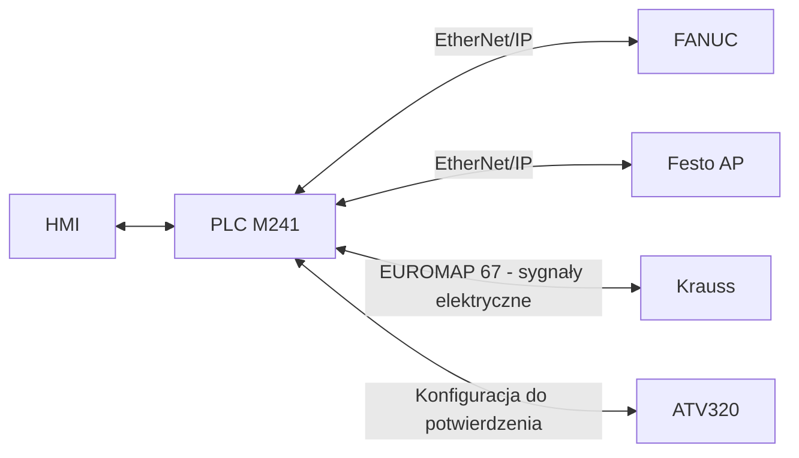

# Założenia projektowe SE-ELDA-Krauss

Data bazowa: 2026-10-04. Status: specyfikacja adaptacji, przed implementacją zmian sterowania.

Dokument opisuje zachowanie docelowe. Źródła ST/LS są odziedziczoną bazą poprzedniego stanowiska. Zapis wymagania nie jest potwierdzeniem jego realizacji ani odbioru maszyny.

## 1. Źródła i status ustaleń

- **POTWIERDZONE** — wymaganie klienta lub odpowiedź użytkownika z planowania, uwzględniona w zaakceptowanym planie.
- **DOMYŚLNE** — jawne założenie projektowe przyjęte w planie lub podczas jego dokumentowania; nie przedstawiać go jako cytatu klienta.
- **OTWARTE** — potrzebne dane lub rozbieżność opisana w rejestrze GAP. Agent nie zastępuje ich zgadywaniem.

Materiały klienta i rejestr ich kopii znajdują się w [źródłach](sources/README.md). Kontrakty opisuje [dokument interfejsów](interfaces.md), a wymagania, testy i otwarte punkty [plan implementacji](implementation-plan.md).

Decyzje użytkownika mają pierwszeństwo przed odziedziczonym opisem starej maszyny. Rozbieżności między docelowym rozwiązaniem a dokumentacją fizycznego sprzętu wymagają wyjaśnienia w odpowiednim GAP.

Wszystkie pliki tworzone i zmieniane w ramach projektu, również pomocnicze, pozostają w `se-elda-krauss`. Poprzednie repozytorium oraz oryginalne materiały zewnętrzne służą tylko do odczytu.

## 2. Architektura i zakres

**POTWIERDZONE**

| Element | Docelowa rola |
|---|---|
| PLC Schneider Electric M241 | Koordynacja stacji, zleceń, wymiany danych oraz końcowych komend wyjść. Schemat wskazuje TM241CE24T. |
| FANUC M-20iD/25, R-30iB Mate Plus | Ruch robota i sekwencja pobierania/odkładania. Wymiana procesowa z PLC przez EtherNet/IP. |
| Festo AP | Rozproszone I/O i pneumatyka; wymiana z PLC przez EtherNet/IP. |
| Krauss | Wymiana sygnałów elektrycznych EUROMAP 67 z PLC. PLC pośredniczy w komunikacji z robotem. |
| ATV320 | Napęd windy. Istniejący kod wykorzystuje GIATV.Control_ATV; docelowa konfiguracja osi i magistrali wymaga potwierdzenia. |
| HMI | Zlecenia, wybór obsługi, statusy, parametry, alarmy i ruchy ręczne. |
| Dedykowany układ bezpieczeństwa | Funkcje bezpieczeństwa poza zwykłą logiką procesu PLC. |

Zachować warstwy: sprzęt i RAW, normalizacja i diagnostyka danych, logiczne interfejsy, sterowanie urządzeniami, sekwencje i koordynacja, HMI. Każde wyjście ma jeden końcowy punkt rozstrzygnięcia komendy.

Zwykły bit HOME nie zastępuje funkcji bezpieczeństwa ani sygnału „obszar formy wolny”. Przebieg obwodów EUROMAP związanych z bezpieczeństwem wymaga potwierdzenia niezależnie od sygnałów procesu. Nie przenosić ich automatycznie do zwykłej wymiany EtherNet/IP.

## 3. Ustalenia użytkownika

| ID decyzji | Potwierdzona decyzja |
|---|---|
| DEC-01 | Start zlecenia tylko otwiera zlecenie i zatwierdza rodzaj produkcji; automat uruchamia fizyczny Start. |
| DEC-02 | Stop kończy bieżący wtrysk, odkładanie oraz rozpoczęte transfery; nie czeka na zapełnienie całego pojemnika/stosu. |
| DEC-03 | Zachować nakładanie wtrysku i odkładania. Stop/Koniec zlecenia kończy także następny wtrysk, jeżeli został już rozpoczęty. |
| DEC-04 | Koniec zlecenia usuwa całą zawartość stacji, także niepełne pojemniki/stosy i puste pojemniki. |
| DEC-05 | Reszta pustych blistrów z P3 przejeżdża w całości transporterami, po opróżnieniu windy. |
| DEC-06 | Ostrzeżenie siłownika blokuje zależny ruch, bez globalnego Stop. |
| DEC-07 | Przy wyłączonej opcji Praca z robotem pracuje samodzielnie tylko wtryskarka; automatyczna paletyzacja i transport produkcyjny są nieaktywne. |
| DEC-08 | Pozwolenia dla pracy samodzielnej Krauss są niezależne od zlecenia i Start automatu, przy HOME i spełnionych blokadach. |
| DEC-09 | Załadunek wykorzystuje osobną barierę, nie zastępczo B101. Jej oznaczenie i adres wymagają uzupełnienia. |
| DEC-10 | V201 i V202 działają równocześnie w Auto, przy oddzielnych sterowaniach i diagnostyce. |
| DEC-11 | V401/V402 otwierają się razem dla robota i zamykają razem przed dostępem operatora; WORK oznacza zamknięcie obu. |
| DEC-12 | Program FANUC jest uruchamiany na robocie. PLC tylko udziela pozwolenia procesowego; brak zdalnego startu UOP. |
| DEC-13 | Cały chwytak, oś pneumatyczna i podciśnienia BAT4 są obsługiwane przez PLC/Festo na żądania robota. |
| DEC-14 | Brakujące dane i materiały stanowią rejestr do uzupełnienia przed zależnym etapem. |
| DEC-15 | Zapisy i edycje są dozwolone wyłącznie wewnątrz se-elda-krauss. |

## 4. Model zlecenia i obsługi

Oddzielić rodzaj produkcji (**Pojemniki/Blistry**), tryb (**Auto/Manual**), stan zlecenia, stan wykonania i ustawienie **Praca z robotem**. Istnienie zlecenia nie może być wyprowadzane ze stanu jednego sekwencera.

| Zdarzenie | Wymagane zachowanie |
|---|---|
| Start zlecenia | Zatwierdzenie rodzaju produkcji i otwarcie zlecenia. Bez ruchu. |
| Fizyczny Start | Uruchomienie/wznowienie automatu po sprawdzeniu warunków. |
| Fizyczny Stop | Zablokowanie nowych cykli i zakończenie rozpoczętych operacji. Zlecenie pozostaje otwarte. Zastępuje starą funkcję przycisku Kontynuuj. |
| Koniec zlecenia | Zakończenie rozpoczętych operacji, opróżnienie stacji, a następnie zamknięcie zlecenia. |
| Reset | Skasowanie usuniętych przyczyn alarmów zgodnie z ich typem; bez komendy ruchu. |
| Alarm krytyczny | Natychmiastowe zatrzymanie automatu; oddzielna reakcja od normalnego Stop. |

**POTWIERDZONE:** praca automatu, poza ruchami ręcznymi, wymaga otwartego zlecenia. Wyjątkiem są uzgodnione pozwolenia dla samodzielnej pracy wtryskarki, która nie stanowi automatycznego cyklu paletyzacji. Podczas opróżniania zlecenie pozostaje aktywne.

**POTWIERDZONE:** wybór Pojemniki/Blistry jest zablokowany aż do zakończenia zlecenia. Nie dopuszczać dwóch aktywnych wyborów naraz.

**DOMYŚLNE:** Start odrzucony z powodu blokady nie jest kolejkowany do późniejszego samoczynnego wznowienia. HMI pokazuje powód odrzucenia.

**OTWARTE (GAP-10):** zachowanie Stop i wejścia w Manual podczas opróżniania, koniec zlecenia wywołany w stanie postoju oraz los dotychczasowej komendy HMI Start. Punktem wyjścia jest pauza po trwającym transferze z zachowaniem jego właściciela i wznowieniem przez fizyczny Start; przed implementacją tej ścieżki trzeba doprecyzować warunki. Nie przenosić starego natychmiastowego AbortAuto jako domyślnej odpowiedzi.

## 5. Zatrzymywanie przy nakładających się operacjach

**POTWIERDZONE:** podczas odkładania detali cyklu N może trwać wtrysk N+1. Stop/Koniec zlecenia:
1. blokuje udzielanie zezwolenia na następny nowy cykl;
2. kończy operacje już rozpoczęte, w tym obsługę N+1, jeśli wtrysk rzeczywiście ruszył;
3. rozlicza pobranie i odłożenie wszystkich tych detali;
4. kończy rozpoczęte transfery i dopiero wtedy potwierdza zatrzymanie albo przechodzi do opróżniania.

Blokowanie nowych cykli nie może odebrać sygnałów niezbędnych do zakończenia rozpoczętej operacji. Równocześnie robot nie może czekać na zamknięcie formy nowego cyklu, którego start został zablokowany.

**OTWARTE (GAP-05):** rzeczywiste sygnały określające rozpoczęcie i zakończenie cyklu Krauss oraz granice ich podtrzymania. Samo wysłane pozwolenie albo stan „forma zamknięta” nie dowodzi rozpoczęcia konkretnego nowego wtrysku.

Stop nie wymaga zapełnienia aktualnego stosu. HOME nie jest samodzielnym potwierdzeniem rozliczenia operacji robota i wtryskarki.

## 6. Pełne opróżnianie i wydawanie jednego stosu

**POTWIERDZONE:** pełne opróżnianie inicjuje wyłącznie Koniec zlecenia. Nie inicjuje go lokalny przycisk transportera dolnego.

Po rozliczeniu operacji robota najpierw można rozładować niepełny stos/pojemnik z windy. Pozostały pusty stos blistrów z P3 jest potem przewożony w całości przez windę. Uwzględnić wszystkie pozostałe pojemniki w buforach.

Każde wydanie dotyczy jednego stosu/pojemnika. Kolejne może ruszyć po potwierdzonym zabraniu poprzedniego na B304. Dopiero odebranie ostatniego ładunku i potwierdzenie pustej stacji zamyka zlecenie.

**DOMYŚLNE z planu:** przycisk lokalny jest obsługiwany zboczem; przytrzymanie nie powtarza wydania. Naciśnięcie bez gotowego stosu nie jest odkładane do późniejszego wykonania.

**DOMYŚLNE:** odbiór wymaga powiązanej z wydaniem sekwencji obecności i zwolnienia B304 z filtracją. Sam zastany stan wolnego B304 nie potwierdza odebrania ładunku, który nie dotarł jeszcze na wyjście.

Model zajętości musi uwzględniać ładunek między czujnikami, zapamiętany ładunek windy, trwający transfer oraz nierozliczone potwierdzenia. Nie uznawać maszyny za pustą wyłącznie na podstawie chwilowo zgaszonych czujników.

## 7. Działanie stacji

| Stacja | Założenia |
|---|---|
| ST.1 — załadunek | Bariera potwierdza przejście całego stosu. Następnie następuje zablokowanie wjazdu i możliwość przygotowania następnego stosu. Oddzielić zwolnienie miejsca załadunku od zakończenia dalszego przejazdu. Zatrzymanie taśmy i warunki poruszania blokad pozostają obowiązujące. |
| ST.2 — winda | V201/V202: oddzielne zawory, krańcówki i diagnostyka, wspólna komenda w Auto, osobne ruchy Manual. Krok kończy się dopiero po obu potwierdzeniach. Zachować bazowanie do krawędzi pojemnika oraz pozycjonowanie pojemnika V203. B205 jest wymaganym wejściem do potwierdzenia w GAP-02. |
| ST.3 — rozładunek | Dodać dwie grupy stoperów przy B302 i B303. Uwzględnić B301 przy oddawaniu ładunku z windy i B304 przy odbiorze operatora. Sterować przesunięciami i stoperami tak, aby wydawać pojedynczo. |
| ST.4 — magazyn przekładek | V401/V402 sterowane oddzielnie, poruszają się razem w sekwencji Auto. WORK = zamknięcie. Dostęp operatora wymaga obu zamkniętych osłon i istniejących zezwoleń/rygli. Dostęp robota wymaga odpowiedniego potwierdzenia otwarcia obu oraz blokad przeciwnego dostępu. |
| ST.5 — robot | Adaptacja obu programów produkcyjnych, całego chwytaka, pośrednictwa do wtryskarki i kończenia cyklu. Rozróżnialne kody kroków i timeoutów. Punkty i konfiguracja narzędzia wymagają sprawdzenia dla nowego robota. |

Zachować P1–P3 na górnym transporterze, P4 na windzie i P5–P7 na dolnym transporterze. Nazwy są logiczne; tabela migracji V/B/M jest w interfejsach.

Podawanie do robota ma pierwszeństwo przed buforowaniem. Transfer P3→P4 i P4→P5 wymaga współpracy obu odpowiednich transporterów. Nie zmieniać pozycji stoperów przy pracującej taśmie.

## 8. Robot, Festo i tryb samodzielny Krauss

Program wybiera i uruchamia operator na FANUC. PLC przesyła oczekiwany rodzaj produkcji, sprawdza zgodność programu i udziela pozwolenia procesowego. Nie projektować automatycznego uruchamiania przez UOP.

Praca z robotem:
- włączenie wymaga aktualnego HOME;
- wyłączenie jest dopuszczalne po zakończonym zatrzymaniu przez Stop;
- po wyłączeniu, przy aktualnym HOME i spełnionych blokadach, wtryskarka otrzymuje uzgodnione pozwolenia do pracy samodzielnej, niezależnie od zlecenia;
- automatyczna paletyzacja i transport produkcyjny pozostają nieaktywne;
- brak HOME daje ostrzeżenie i brak tych pozwoleń;
- utracona aktualność HOME nie jest traktowana jak zachowane HOME.

Cała pneumatyka BAT4 jest sterowana przez Festo/PLC na logiczne żądania robota. Obejmuje oś pneumatyczną, siłowniki chwytaka, podciśnienia, przedmuchy i sygnały zwrotne. Wszystkie potwierdzenia trafiają do robota przez PLC według rzeczywistego mapowania, w tym z lokalnych wejść KEC3. Nie oznacza to obowiązku fizycznego przepinania tych czujników do Festo. Robot nie steruje dodatkowo starym równoległym kanałem RI/RO.

Pełna lista pozwoleń wtryskarki, polaryzacje i czasy podtrzymania pozostają w GAP-05. Nie zastępować ich ogólnym „wszystkie pozwolenia TRUE”.

## 9. Alarmy i HMI

**POTWIERDZONE**
- Krytyczne: czerwony andon i natychmiastowe zatrzymanie automatu.
- Ostrzeżenia: pomarańczowy andon bez globalnego Stop.
- Usterka siłownika transportera, pozycjonowania windy lub osłony magazynu blokuje zależny ruch i czeka na prawidłowe potwierdzenie.
- Ta sama przyczyna nie może eskalować do krytycznej przez nadrzędny timeout oczekiwania.
- Progi alarmowe są konfigurowane w parametrach odpowiedniej stacji.

Nie utożsamiać ostrzeżenia siłownika na windzie z dowolnym błędem napędu ATV320. Klasyfikacja błędów chwytaka, utraty podciśnienia, falownika, sprzecznych danych i urządzeń komunikacyjnych wymaga macierzy alarmów (GAP-12).

| Karta HMI | Zawartość |
|---|---|
| HOME | Ikony ST.1–ST.5 z kolorami statusu; Auto, Manual, Praca z robotem, Reset. |
| Zlecenie | Start zlecenia, Koniec zlecenia, wybór Pojemniki/Blistry i stan wykonania. |
| Alarmy | Krytyczne i ostrzeżenia, źródło/stacja, przyczyna i możliwość skasowania. |
| Stacja | Wejście z ikony HOME; statusy i diagnostyka stacji. |
| Parametry stacji | Czasy i progi; reset stanów, zwłaszcza windy, dostępny tylko w Manual. Brak parametrów oznacza pustą kartę. |
| Ruchy manualne | Sterowanie urządzeniami; w Auto nieaktywne. Podgląd EUROMAP i dozwolone ręczne sygnały do wtryskarki. |

Receptury są poza zakresem. Dodać stany „zatrzymywanie”, „opróżnianie”, „oczekiwanie na odbiór”, dostępność komend i przyczynę blokady.

Ręczny EUROMAP wymaga Manual, aktualnego HOME oraz zatrzymanej współpracy automatycznej. Przejście w Auto kasuje ręczne wymuszenia. PLC sprawdza blokady niezależnie od HMI. Nie udostępniać ręcznego wymuszania funkcji bezpieczeństwa jako zwykłego sterowania procesowego.

## 10. Odzyskiwanie pracy

**DOMYŚLNE z planu:** Reset, powrót komunikacji i powrót zasilania nie uruchamiają ruchu. Po zatrzymaniu krytycznym wymagany jest fizyczny Start, aktualne pozwolenia i sprawdzenie spójności procesu.

Przed wznowieniem sprawdzić ładunki między czujnikami, pozycję windy, detal/tackę/przekładkę w chwytaku, cykl wtryskarki, stan transferów i nierozliczone żądania/potwierdzenia. Nie odtwarzać zapamiętanego impulsu jako nowego zdarzenia.

**OTWARTE (GAP-11):** retencja zlecenia i liczników oraz procedura uzgadniania stanu po restarcie. Do rozstrzygnięcia pozostaje sposób odzyskania informacji, a nie zakaz automatycznego wznowienia.

Natychmiastowy Stop krytyczny nie oznacza automatycznie wyłączenia wszystkich cewek. Stan zaworów i podciśnienia musi wynikać z rzeczywistej pneumatyki (GAP-08). Oprogramowanie nie może domyślnie wywołać zwolnienia trzymanego ładunku.

## 11. Warunki przejścia do implementacji

Kolejność prac, zależności i dowody odbioru określa [plan implementacji](implementation-plan.md). Można wykonywać niezależne prace mimo otwartych GAP; niedopuszczalne jest zastępowanie brakującego wejścia stałą TRUE, fikcyjnym adresem albo pustym podprogramem.

Dokumentacja nie usuwa obecnych pozostałości testowych z kodu. Ich konkretne miejsca oraz kryteria zastąpienia są zarejestrowane w planie.
